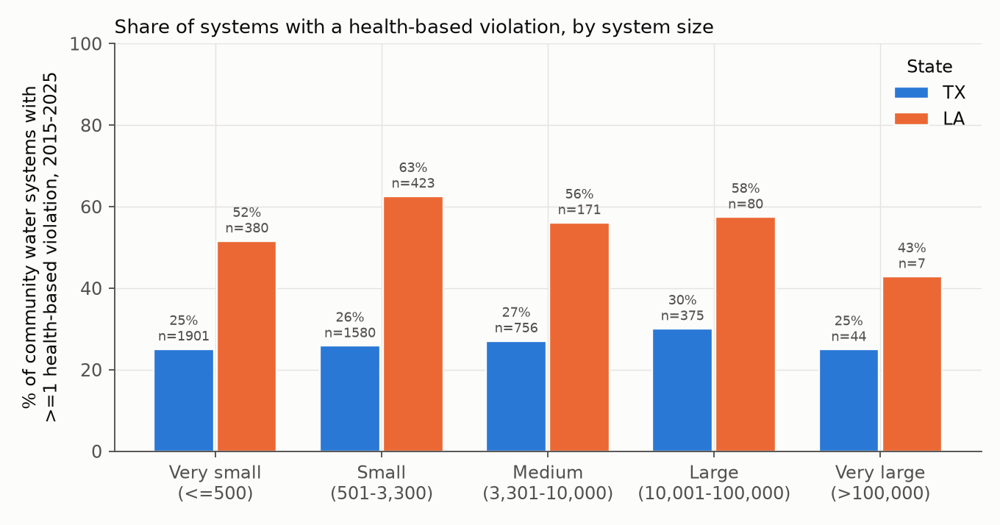
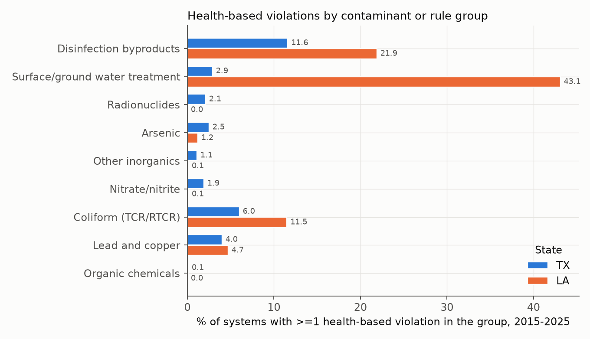
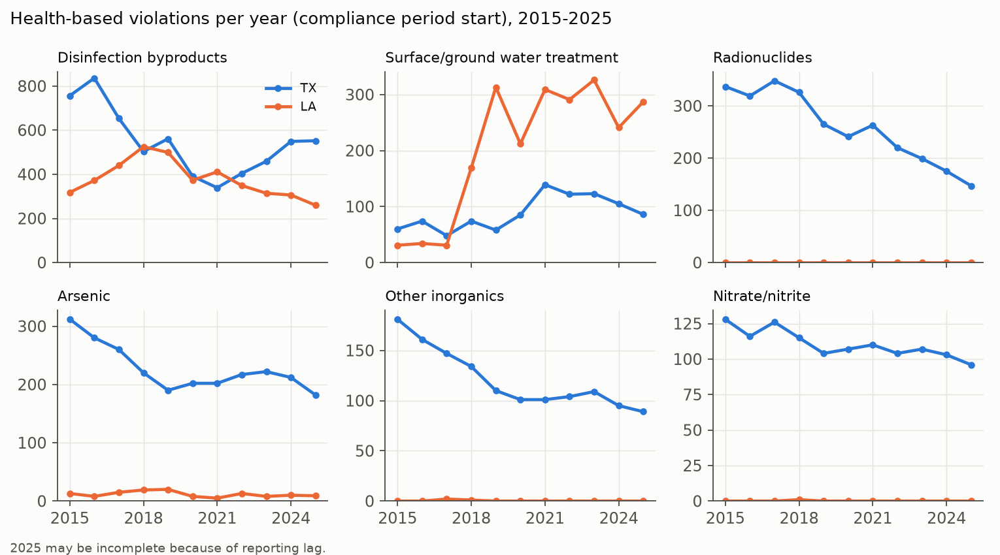
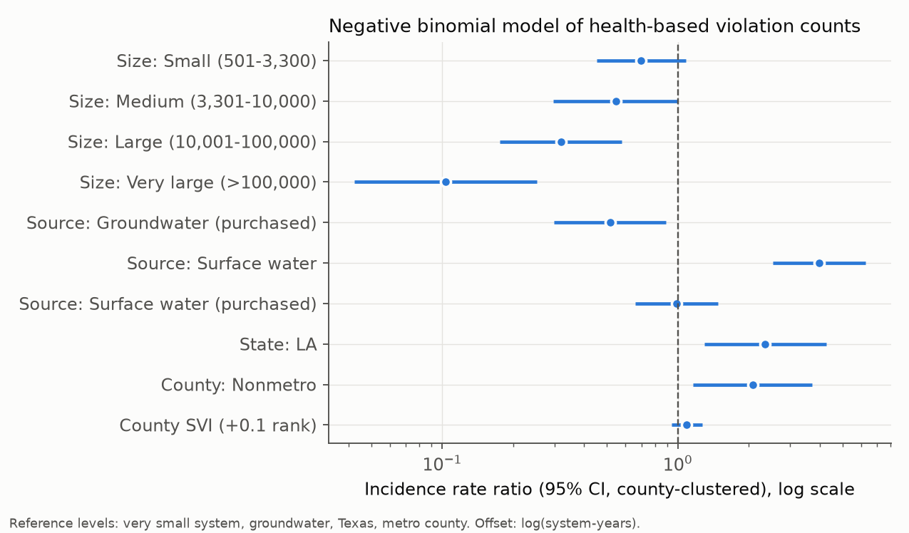
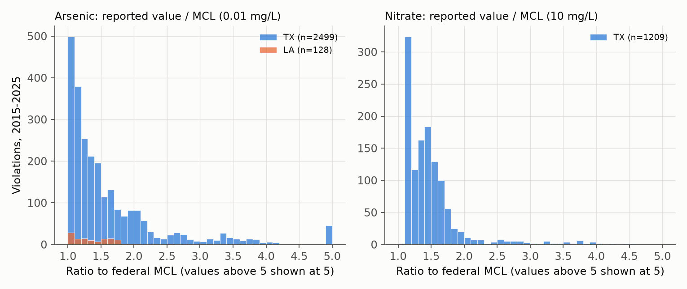
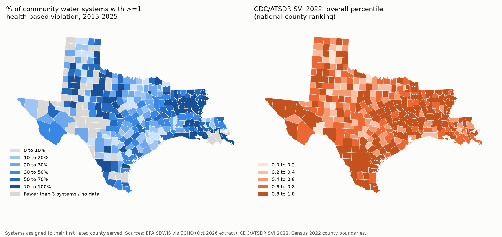
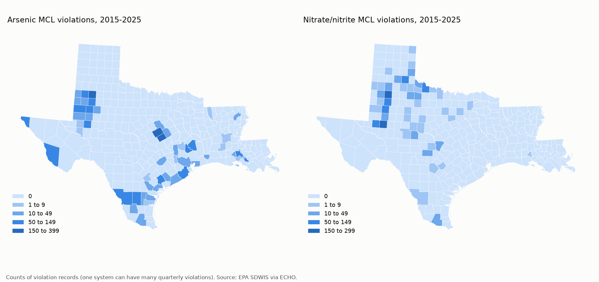

# Health-based drinking water violations at community water systems in Texas and Louisiana, 2015-2025

This project describes health-based Safe Drinking Water Act violations reported to EPA for the 6,144 community water systems (CWS) that operated in Texas and Louisiana at some point from 2015 through 2025. It uses the EPA SDWIS extract published through ECHO, links each system to its primary county, and joins county social vulnerability (CDC/ATSDR SVI 2022) and rurality (USDA Rural-Urban Continuum Codes 2023). It reports violation rates by state, system size, source water and contaminant group, fits negative binomial and logistic models, maps county patterns, and looks more closely at arsenic and nitrate. The results describe regulatory compliance records. They do not measure exposure or health outcomes.

This is an independent analysis of public data. It is separate from, and uses none of, the datasets from my LSU dissertation research.

Author: Anamika Dristi, Ph.D.

## Why it matters

Small and rural water systems carry most of the compliance burden in both states, and groundwater chemistry (arsenic, nitrate, radionuclides, fluoride) drives a large share of Texas violations. Knowing which systems, sources and counties have repeated health-based violations is basic information for environmental health programs, drinking water and source water protection work, and GIS-based screening in Texas and Louisiana (for example at TCEQ, LDH, LDEQ, county health departments and water utilities). The arsenic and nitrate section connects to water chemistry and nutrient work in my research background.

## Data sources

All data are public and were downloaded without an account or API key on 2026-10-23 (see `data/download_log.csv`).

| Source | What was used | Link | Version |
|---|---|---|---|
| EPA ECHO SDWA bulk download (SDWIS) | Water system inventory, counties served, violations | https://echo.epa.gov/files/echodownloads/SDWA_latest_downloads.zip | File dated 2026-10-14, submission quarter 2026Q3 |
| CDC/ATSDR Social Vulnerability Index 2022 | County overall SVI percentile (RPL_THEMES) | https://svi.cdc.gov/Documents/Data/2022/csv/states_counties/SVI_2022_US_county.csv | SVI 2022, US county file (national ranking) |
| USDA ERS Rural-Urban Continuum Codes 2023 | Metro (RUCC 1-3) vs nonmetro (RUCC 4-9) | https://www.ers.usda.gov/media/5768/2023-rural-urban-continuum-codes.csv | RUCC 2023 |
| U.S. Census Bureau cartographic boundaries | County and parish polygons | https://www2.census.gov/geo/tiger/GENZ2022/shp/cb_2022_us_county_500k.zip | 2022, 1:500,000 |

The SDWA zip is about 560 MB (5.2 GB unzipped; the violations table alone is 4.1 GB). It is not stored in this repository. `scripts/01_download_data.py` downloads it and keeps only Texas and Louisiana rows (1,235,023 violation and enforcement rows, 21,799 water system rows). Only small derived tables are kept in `data/`.

## Methods

**Systems.** Community water systems (`PWS_TYPE_CODE = CWS`) with a Texas or Louisiana PWSID that operated for at least 3 months between 2015-01-01 and 2025-12-31. Operating time (system-years) runs from the later of 2015-01-01 or the first reported date to the earlier of 2025-12-31 or the deactivation date. Inactive systems without a deactivation date were excluded. This gives 6,144 systems (Texas 5,064, Louisiana 1,080) and 62,283 system-years.

**Attributes.** Population served and source water are the values in the current SDWIS inventory, not year by year. Size classes follow EPA categories (very small up to 500 people, small 501-3,300, medium 3,301-10,000, large 10,001-100,000, very large over 100,000). 427 systems, mostly deactivated Texas systems, report a population of 0 and are kept in descriptive totals but excluded from models. Source is groundwater or surface water (groundwater under the influence of surface water counted as surface water), split by whether the water is purchased from another system. Each system was assigned to the first county it lists as served.

**Violations.** Health-based violations (`IS_HEALTH_BASED_IND = Y`: MCL, MRDL and treatment technique violations) whose compliance period began in 2015-2025, counted once per violation ID. Groups follow the SDWIS rule code: disinfection byproducts (Stage 1 and 2 DBP rules), coliform (TCR and RTCR), surface and ground water treatment rules (SWTR, IESWTR, LT2, Ground Water Rule), nitrate/nitrite, arsenic, other inorganics (mostly fluoride), radionuclides, lead and copper, and organic chemicals. In October 2024, 1,245 systems received a Lead and Copper Rule Revisions "LSL Inventory" violation (code 2E) that SDWIS flags as health-based. These concern the service line inventory deadline rather than a measured contaminant, so they are reported separately and left out of all totals and models.

**Rates.** Violations per 100 system-years, percent of systems with at least one violation in the period, and the population served by systems with at least one violation.

**Models** (Python, statsmodels):
- Negative binomial (NB2) model of each system's health-based violation count with an offset for log(system-years). Covariates: size class, source type, state, county SVI (per 0.1 of the national percentile rank) and metro/nonmetro county. Standard errors are clustered by county. n = 5,716 systems in 318 counties.
- Logistic model of having any health-based violation, for the 5,177 systems that operated through the whole 2015-2025 window.
- Sensitivity models: SVI quartiles instead of a linear term; dropping treatment-rule violations; Texas and Louisiana fitted separately.
- Logistic models of any arsenic, any nitrate (Texas only, because Louisiana had no nitrate MCL violations) and any DBP violation, with log10(population) in place of size class.

**Maps.** County choropleths with matplotlib and geopandas. Counties with fewer than 3 systems are shown in gray on the percentage map.

## Key findings

Numbers below are from `outputs/tables/` produced by the scripts in this repository.

1. **Overall.** 1,899 of 6,144 systems (30.9%) had at least one health-based violation in 2015-2025, for 22,666 violations (36.4 per 100 system-years). These systems serve 13.8 million people according to SDWIS, which is the population served by a system with any violation during the period, not the number of people who received water above a standard.
2. **State.** The share was higher in Louisiana (56.7% of systems, 63.9 per 100 system-years) than in Texas (25.4%, 30.6 per 100 system-years). Much of the gap comes from one record type: 2,033 Louisiana Ground Water Rule violations for "failure to address deficiency" (an uncorrected sanitary survey finding). In the model that drops treatment-rule violations, the Louisiana incidence rate ratio (IRR) falls from 2.35 (95% CI 1.30-4.26) to 1.56 (0.79-3.07). Differences between states can reflect how each primacy agency identifies and reports violations, not only water quality.
3. **System size.** Violation counts per system-year fall with system size. Compared with very small systems, the adjusted IRR was 0.32 (0.18-0.58) for large and 0.10 (0.04-0.25) for very large systems. The share of systems with any violation varied less by size (Texas 25-30% in every class), so larger systems were about as likely to have a violation but had fewer repeated ones.
4. **Source water.** Systems that treat their own surface water had more violations than groundwater systems (IRR 3.98, 2.54-6.25; any-violation OR 7.50, 5.21-10.79), driven by disinfection byproducts: 45.1% of surface water systems had a DBP violation, compared with 8.1% of groundwater systems.
5. **Contaminant groups.** Disinfection byproducts were the largest group (10,170 violations; 13.4% of systems), followed by treatment-rule violations (3,218; 10.0%), radionuclides (2,840; 1.8%), arsenic (2,627; 2.3%), other inorganics (1,335; 0.9%), nitrate/nitrite (1,217; 1.6%), coliform (623; 7.0%) and lead and copper treatment technique violations (564; 4.1%). Radionuclide, fluoride and nitrate violations were almost entirely in Texas.
6. **County vulnerability and rurality.** Systems in nonmetro counties had about twice the violation rate of systems in metro counties after adjustment (IRR 2.08, 1.16-3.72). The pooled SVI term was small and not statistically clear (IRR 1.09 per 0.1, 0.94-1.27), and SVI quartiles did not show a consistent gradient. In the Louisiana-only model, SVI was associated with more violations (IRR 1.27 per 0.1, 1.09-1.49); in Texas it was not (1.07, 0.91-1.26). At the county level, the Spearman correlation between SVI and the share of systems with a violation was weak (rho = 0.16 across 273 counties with at least 3 systems). Because SVI is a county measure applied to every system in the county, these are ecological associations.
7. **Trends.** Texas arsenic, radionuclide and other inorganic violations declined from 2015 to 2025 (arsenic from 312 to 182 per year). Louisiana treatment-rule violations rose after 2018, almost all Ground Water Rule deficiency records. Counts for 2025 may still be incomplete.

### Arsenic and nitrate

- **Arsenic.** 2,627 arsenic MCL violations at 139 systems in 50 counties or parishes (Texas 126 systems in 43 counties; Louisiana 13 systems in 7 parishes). The median reported value was 0.014 mg/L, 1.4 times the 0.010 mg/L MCL; the Texas 90th percentile was 0.027 mg/L. About 90% of the systems with arsenic violations rely on groundwater. Counties with the most violation records were Lubbock (387 records, 13 systems), McLennan (323, 9), Falls, Duval, Polk and Gaines. In the arsenic model, systems in more vulnerable counties had higher odds of any arsenic violation (OR 1.36 per 0.1 SVI, 1.06-1.74; 120 systems with an event), and purchased surface water systems had lower odds (OR 0.23).
- **Nitrate.** 1,209 nitrate MCL violations at 92 Texas systems in 41 counties, plus 8 nitrite violations. Louisiana community systems had no nitrate MCL violations in this period. The median reported value was 14 mg/L (as N) against the 10 mg/L MCL, with a 90th percentile of 19 mg/L. Violations were concentrated in West Texas counties (Midland 269 records, Lubbock 185, Wilbarger, Ector, Hall, Lynn, Dawson). They were also most common in the smallest systems: 3.2% of very small Texas groundwater systems had one, compared with 0.2% of medium systems. In the Texas nitrate model, each tenfold increase in population served was associated with lower odds of a violation (OR 0.39, 0.27-0.56).
- These patterns fit the known presence of arsenic and nitrate in parts of the Texas aquifer system, but this analysis does not test any geologic or land-use explanation.

### Caveats on interpretation

- A violation means a system failed a regulatory standard or required treatment step for a compliance period. It does not tell how many people drank water above a standard, for how long, or at what dose.
- One system can generate many records for one ongoing problem (for example, quarterly running-average arsenic or radionuclide violations), so counts are heavily overdispersed (NB alpha = 8.3). Percent of systems with any violation is a steadier measure.
- No health outcomes were analyzed, and none should be inferred from these results.

## Figures















## Limitations

- SDWIS data quality depends on state reporting. Texas (TCEQ) and Louisiana (LDH) differ in how they record some violations, so state comparisons should be read with care.
- Population served and source type are current inventory values applied to the whole period. Deactivated systems often report a population of 0.
- Each system is placed in the first county it lists, which can misplace systems that serve several counties (only 1 of the 6,144 systems lists more than one county in SDWIS, so systems whose service area crosses county lines are placed in one county). Service area boundaries were not used.
- County SVI and rurality describe the county, not the community each system serves. Small systems in a county can serve very different populations.
- Violations are dated by the start of the compliance period. Recent years, especially 2025, may be incomplete because of reporting lag.
- Only community water systems are included; transient and non-transient non-community systems (schools, businesses, campgrounds) and private wells are not.
- The models are descriptive. They do not identify causes of violations, and several models were fitted, so single p-values should not be over-read.

## GIS files and ArcGIS Pro

ArcGIS Pro was not used or run for this project. All processing and maps were made with open-source Python (geopandas, matplotlib). For GIS users, `outputs/gis/` contains:

- `county_violation_summary_txla.gpkg`: county polygons (EPSG:5070, CONUS Albers) with the summary fields from `outputs/tables/t11_county_summary.csv`. ArcGIS Pro and QGIS open GeoPackages directly.
- `county_violation_summary_txla.kml`: the same counties in WGS84 for Google Earth.

To reproduce a map in ArcGIS Pro yourself: Add Data, select the `county_summary` layer in the GeoPackage, then Symbology > Graduated Colors on `pct_any_hb` (or `svi_2022`, `as_viol`, `no3_viol`) with manual breaks matching the figures, and use a definition query `n_cws >= 3` for the percentage map.

## How to run

```bash
python -m venv .venv
source .venv/bin/activate
pip install -r requirements.txt
./run_all.sh                 # or set RAW_DIR=/path/with/space to store the raw downloads elsewhere
```

The steps can also be run one at a time:

```bash
python scripts/01_download_data.py --raw-dir raw_data   # about 560 MB download, 6 GB disk after unzipping
python scripts/02_build_tables.py --raw-dir raw_data
python scripts/03_analysis.py
python scripts/04_county_maps.py --raw-dir raw_data
```

The full pipeline takes a few minutes after the download. Because the EPA file is updated regularly, a later download will give slightly different counts.

## Repository structure

```
drinking-water-violations-tx-la/
  README.md
  LICENSE
  requirements.txt
  run_all.sh
  scripts/
    01_download_data.py      download sources, subset SDWIS to TX and LA
    02_build_tables.py       system, violation and county covariate tables
    03_analysis.py           rates, models, arsenic and nitrate section, figures 1-5
    04_county_maps.py        county summary, maps (figures 6-7), GeoPackage and KML
  data/
    cws_systems_txla_2015_2025.csv        one row per community water system
    hb_violations_cws_txla_2015_2025.csv  one row per health-based violation
    county_covariates_txla.csv            SVI 2022 and RUCC 2023 by county
    download_log.csv                      URLs, file sizes and access dates
  outputs/
    tables/    t01-t12 summary and model tables
    figures/   fig01-fig07
    gis/       county GeoPackage and KML
```

## Citation and author

Anamika Dristi, Ph.D. (2026). Health-based drinking water violations at community water systems in Texas and Louisiana, 2015-2025. GitHub repository: drinking-water-violations-tx-la.

Data: U.S. EPA Safe Drinking Water Information System (SDWIS), via ECHO SDWA downloads; CDC/ATSDR Social Vulnerability Index 2022; USDA ERS Rural-Urban Continuum Codes 2023; U.S. Census Bureau 2022 cartographic boundary files.

Related published work on water chemistry, cited for context only:
- Dristi, A., & Xu, Y. J. (2023). Water, 15(14), 2621.
- Dristi, A., & Xu, Y. J. (2025). Water, 17(17), 2589.
- Dristi, A., et al. (2025). Estuarine, Coastal and Shelf Science, 324, 109465.

Contact: anamikadristi@gmail.com
